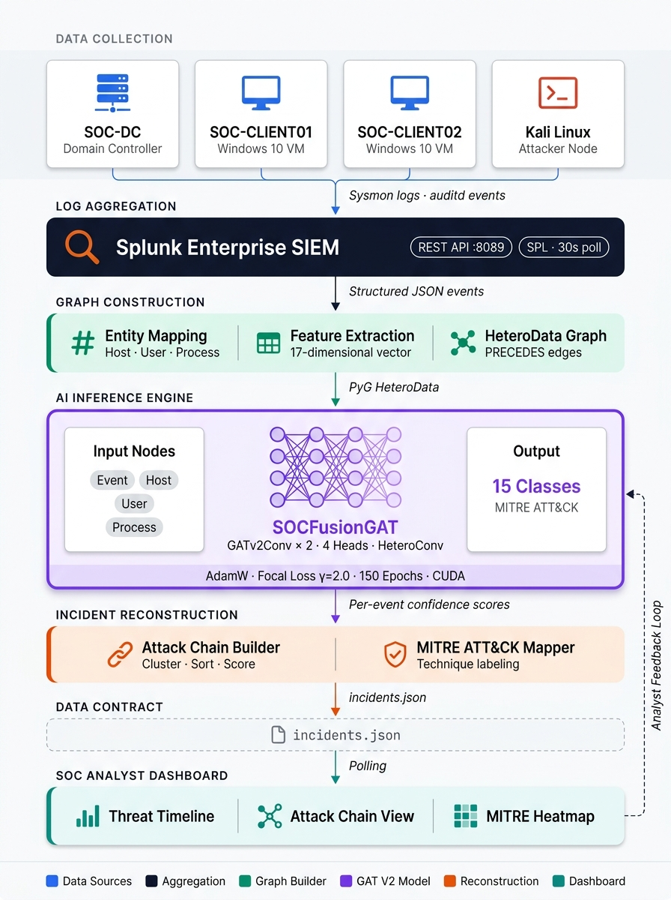
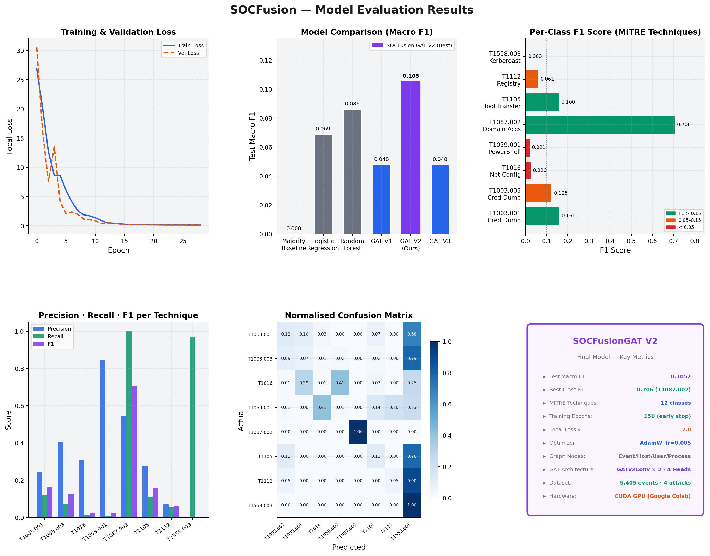

# SOCFusion

**SOCFusion** is an AI-powered Security Operations Center (SOC) threat detection and analysis system that leverages Graph Attention Networks (GAT) and MITRE ATT&CK framework integration to detect, reconstruct, and visualize cyberattack chains in real time.

---

## 🔍 Overview

SOCFusion fuses provenance graph analysis with machine learning to:
- Detect anomalous behaviour in host telemetry using a self-supervised Graph Attention Network
- Reconstruct multi-stage attack chains from raw endpoint events
- Map detected techniques to MITRE ATT&CK tactics and techniques
- Expose results through an interactive SOC analyst dashboard

---

## 🏗️ Architecture



---

## 📁 Project Structure

```
SOCFusion/
├── src/
│   ├── app/                    # Analyst dashboard (Flask/Dash)
│   │   └── app.py
│   ├── models/                 # GAT model definitions
│   │   ├── gat.py
│   │   ├── losses.py
│   │   └── train_gat_contrastive.py
│   ├── data/                   # Data processing pipeline
│   │   ├── graph_construction_v5.py
│   │   ├── apply_labels_v3.py
│   │   └── ...
│   ├── analysis/               # Evaluation & analysis scripts
│   ├── attack_chain/           # Attack chain reconstruction
│   ├── mitre/                  # MITRE ATT&CK mapper
│   ├── training/               # Training orchestration
│   ├── deployment/             # Live inference service
│   └── pipeline/               # End-to-end pipeline runner
├── tests/                      # Unit tests
├── SOCFusion_GAT_V2_deployment/# Deployment config & weights
│   ├── gat.py
│   └── training_config.json
├── SOCFusion_Architecture_Final.jpg
├── SOCFusion_Results.jpg
├── run.py                      # Main entry point
├── run_live_socfusion.sh       # Live inference launcher
└── setup_features.sh           # Feature environment setup
```

---

## 🚀 Quick Start

### 1. Install Dependencies

```bash
python -m venv venv
source venv/bin/activate
pip install torch torch-geometric dash flask pandas numpy scikit-learn
```

### 2. Prepare Data

Place your OPTC/endpoint telemetry in `data/`. Run the preprocessing pipeline:

```bash
python src/data/graph_construction_v5.py
python src/data/apply_labels_v3.py
```

### 3. Train the Model

```bash
python src/models/train_gat_contrastive.py
```

### 4. Run the Dashboard

```bash
python src/app/app.py
```

### 5. Live Inference

```bash
bash run_live_socfusion.sh
```

---

## 🧠 Model

SOCFusion uses a contrastive self-supervised Graph Attention Network (GAT) trained on provenance graphs built from host telemetry. Key capabilities:

- **Multi-head attention** over process/file/network provenance edges
- **Contrastive learning** to distinguish benign vs. attack subgraph patterns  
- **MITRE ATT&CK mapping** for technique-level attribution
- **Detection gap analysis** to surface missed attack stages

---

## 📊 Results



---

## 📄 License

This project is for research and academic purposes.
